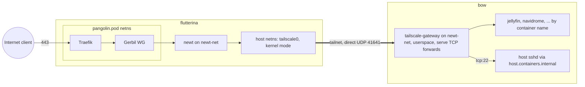

# Tailscale: replacing newt as the backhaul, Pangolin kept as the public edge

Status: scoping only, nothing implemented. Tracked in #163.

## Goal

- **Now:** Pangolin stays as the public edge on flutterina. Some devices
  that use the media apps cannot run Tailscale (TVs and similar), so public
  endpoints on the custom domain are still required. Tailscale replaces
  **newt as the transport** between flutterina and the other sites (bow,
  Home Assistant), one resource at a time.
- **End state (deferred):** tailnet-only, no public edge. The user's exit
  criteria: Tailscale offers an identity-based SSH/PAM equivalent to
  Pangolin's SSH auth daemon, peer routing works for custom domains, and
  public-endpoint performance is acceptable. Today Funnel only serves
  `*.ts.net` names, only on ports 443/8443/10000, under non-configurable
  bandwidth limits, and is still beta. Tailscale Services have the same
  `ts.net`-only naming. Re-evaluate when that changes. Devices that cannot
  run Tailscale still need a public URL whatever Tailscale ships.

Non-goals for this plan: removing Pangolin, Gerbil, Traefik or badger;
Tailscale SSH; MagicDNS on hosts; exit nodes.

## Live inventory (Pangolin API, 2026-10-23)

| Resource | Mode | Site → target | SSO | Target HC |
|---|---|---|---|---|
| Aonsoku | http | bow → `aonsoku:8080` | off | on |
| Audiobookshelf | http | bow → `audiobookshelf:80` | off | on |
| Grimmory | http | bow → `grimmory:6060` | off | on |
| Jellyfin | http | bow → `jellyfin:8096` | off | on |
| Media Manager | http | bow → `mediamanager:8000` | **on** | off |
| Navidrome | http | bow → `navidrome:4533` | off | on |
| BST Cache Index | tcp :7981 | bow → `bb-asset:7981` | — | on |
| BST Cache Storage | tcp :7982 | bow → `bb-storage:7982` | — | on |
| Beszel | http | flutterina → `beszel-hub:8090` | off | on |
| Home Assistant | http | home-assistant → HA `:8123` | off | on |

Also present: a bow `mode: "host"` site resource for SSH (`tcp 22`, Pangolin
auth daemon in `pamMode: passthrough`), three newt sites (bow, flutterina,
home-assistant), one IdP (Zitadel OIDC), **zero alert rules**, and no
`clients`. Bow's site has moved about 1.4 TB in and 2.0 TB out.

Pangolin's CGNAT usage, which matters for Tailscale addressing:
`gerbil.subnet_group: 100.89.137.0/20` (= `100.89.128.0/20`, the site /30s),
and org/client addresses seen in `100.90.128.0/24` and `100.96.128.0/24`.

## Transitional architecture

### Pangolin target path: flutterina's newt site (T2), not a local site (T1)

| | T1: Pangolin "local" site, target = bow tailnet IP | T2: flutterina's newt site, target = bow tailnet IP |
|---|---|---|
| Health checks / failover | **Not supported** on local sites (Pangolin docs, Understanding Sites) | Kept. Newt runs the probes |
| Data path | Traefik → host → tailscale0 | Traefik → Gerbil → flutterina newt (userspace WG) → host → tailscale0 |
| Extra hop cost | none | one same-host userspace WG hop. bench:vps measured 1781 Mbit/s for userspace WG on one cpx12 vCPU, far above bow's uplink [INFERENCE: cx23 similar order] |
| Needs | new local site in Pangolin | nothing new. `DOCKER_ENFORCE_NETWORK_VALIDATION` has no dial-time check (AGENTS.md), so a non-container target proxies fine |

Recommendation: T2 for every resource, because 9 of 10 targets rely on target
health checks today. Fall back to T1 for Jellyfin only if the phase-3
measurement shows the extra hop limits throughput.

Both options need flutterina's **host netns** to route to the tailnet, which
means a kernel-mode node with `Network=host`. Bow does not need host-level
routing: its gateway only has to accept inbound traffic.

## Components

Two components. The bow gateway's serve config is bow-specific content, so
a single component switched by `{{ if exists }}` would ship an empty
serve config to every other host.

### `tailscale` — host-level node (flutterina, krytis-runner)

Assigned via a new `[Roles.tailnet]`.

- `Network=host`, `Environment=TS_USERSPACE=false`,
  `AddDevice=/dev/net/tun`, `AddCapability=NET_ADMIN NET_RAW`
- `tailscale-state.volume` → `TS_STATE_DIR=/var/lib/tailscale`,
  `TS_AUTH_ONCE=true`
- `{{ secretEnv "tailscaleAuthKey" "TS_AUTHKEY" }}`. The attribute lives in
  vault `globals`, because it is shared by both components (see the
  per-component attribute scoping gotcha in AGENTS.md).
- `TS_HOSTNAME={{ m_facts "hostname" }}`,
  `Environment="TS_EXTRA_ARGS=--advertise-tags=tag:server"`
- Health: `TS_ENABLE_HEALTH_CHECK=true`,
  `TS_LOCAL_ADDR_PORT=127.0.0.1:9002`. Never the default `[::]:9002`: with
  `Network=host` and no host firewall on flutterina, that would be a public
  port. Check with `HealthCmd=wget -qO- http://127.0.0.1:9002/healthz`.
- Firewall backend: match podman/netavark's driver on each host
  (`TS_DEBUG_FIREWALL_MODE=nftables|iptables`). Mixing iptables-legacy and
  nft rules is a known source of silent breakage. Check
  `podman info` → network backend / firewall driver first.

### `tailscale-gateway` — bow, the newt analogue

Assigned in `[Hosts.bow] Components`.

- `Network=newt-net`, userspace (the image default), no capabilities, no
  PublishPort. Container-netns only, so it needs **no nftables change on
  bow**: the tunnel UDP is outbound-initiated, and it never touches the host
  netns where Tailscale's CGNAT drop rule would otherwise land.
- `tailscale-gateway-state.volume`, the same auth env vars, and
  `TS_EXTRA_ARGS=--advertise-tags=tag:gateway`.
- `serve/serve.json` data resource, mounted **as a directory**: Tailscale
  docs say a single-file bind misses config updates.
  `TS_SERVE_CONFIG=/config/serve/serve.json` contains plain TCP forwards
  by container name:
  `8080→aonsoku:8080, 80→audiobookshelf:80, 6060→grimmory:6060,
  8096→jellyfin:8096, 8000→mediamanager:8000, 4533→navidrome:4533,
  7981→bb-asset:7981, 7982→bb-storage:7982, 22→host.containers.internal:22`.
  The last forward gives bow an SSH path that is independent of the edge.
  AGENTS.md already confirms that `host.containers.internal:22` is
  reachable from `newt-net`.
- `RestartedBy = ["tailscale-gateway.container", "serve/serve.json"]`

Unverified until the POC:

1. `TCPForward` accepting a container *hostname* rather than an IP.
2. Userspace serve forwarding sustaining Jellyfin-class throughput.
3. Busybox `wget` being present in the image for the health check.

## Tailnet-side setup (admin console)

1. **`ipPool`** for all nodes, disjoint from Pangolin's ranges, e.g.
   `100.70.0.0/16`. This makes routing to bow's tailnet IP from the pod netns
   deterministic: no overlap with Gerbil's `100.89.128.0/20` routes. Renumber
   any existing nodes; `ipPool` only affects new ones.
2. Tags `tag:server` and `tag:gateway`. Grants:
   - flutterina → gateway on the app ports
   - krytis-runner and the workstation → gateway `tcp:7981-7982`
   - admin → `tcp:22` everywhere
   - flutterina → HA `tcp:8123`
   - nothing from tagged nodes to personal devices
3. OAuth client secret (`?ephemeral=false&preauthorized=true`) as
   `tailscaleAuthKey`. This avoids the ≤90-day expiry of plain auth keys on
   re-provision. Tagged nodes get node-key expiry disabled.
4. Optional: tailnet login through the existing Zitadel (Tailscale custom
   OIDC needs WebFinger on the domain).

Plan limit: Personal is 3 users / 100 devices. Non-Tailscale devices keep
using the public edge, so they don't count against it.

## Phases (any component failure aborts materia for the whole host)

0. **Tailnet + vault.** Pool, tags, grants, credential.
   `globals.tailscaleAuthKey` must be in the vault before any assignment.
1. **flutterina `tailscale`** (Hetzner console as fallback).
   - Verify: no `FATA` in `journalctl -u materia-update.service`.
   - Every public hostname still answers (the CGNAT drop rule is in the host
     netns, Gerbil's tunnels in the pod netns [INFERENCE: no conflict]).
   - Tailnet SSH to flutterina works.
2. **bow `tailscale-gateway`.**
   - Verify from flutterina:
     `curl http://<bow-ts-ip>:8096/health`, `ssh -p 22 <bow-ts-ip>`.
   - `tailscale ping` from flutterina shows a direct path, not DERP.
     flutterina has no host firewall, so 41641/udp is open.
3. **Retarget resources one at a time** in Pangolin (T2: site =
   flutterina, target = `<bow-ts-ip>:<port>`).
   - Order: Media Manager → Grimmory → Audiobookshelf → Navidrome +
     Aonsoku → Jellyfin.
   - Before Jellyfin, run a remote 4K stream (or iperf through the gateway)
     on both paths and compare.
   - Rollback = flip the target back to site bow + container name.
4. **Buildbarn off Pangolin entirely.**
   - krytis-runner joins via `Roles = ["tailnet"]` (adopted, non-Flatcar:
     confirm `/dev/net/tun` and its local firewall). The workstation
     installs Tailscale manually.
   - The server cert's SAN is `bst-cache.<baseDomain>`. Point that name at
     bow's tailnet IP (public A record to a 100.x address, or `/etc/hosts`
     on the clients). Re-issuing the cert would also mean rotating the
     `serverKeyPem` secret.
   - Update the cache endpoint in the krytis repo.
   - Then remove both raw resources, `PublishPort=7981/7982` from
     `pangolin.pod`, the two Traefik entryPoints, and
     `allow_raw_resources`.
   - Delete `components/buildbarn/blueprint-resources.yaml`.
5. **Home Assistant** (not in this repo; runbook only).
   - Install the HA Tailscale add-on and retarget the resource T2-style to
     `<ha-ts-ip>:8123`.
   - Add flutterina's tailnet IP to HA's `http.trusted_proxies` *first*.
     HA answers `400` to forwarded requests from an untrusted proxy.
   - Then delete the home-assistant newt site.
6. **Retire newt on bow.**
   - Every bow app and the gateway join `newt-net`, which the `newt`
     component owns. Dropping `tunneled` from bow would delete the network
     out from under every app. Move network ownership first: either a new
     network in `tailscale-gateway`, with apps joining both during the
     switch, or move `newt.network` into another component in a separate
     verified run.
   - Then remove the bow site and the bow SSH site resource from Pangolin.
   - flutterina keeps newt: it runs the T2 health checks and fronts
     beszel-hub.
7. **AGENTS.md:** layout entries, the architecture decision, and gotchas
   found along the way.

## Risks

- **Whole-host materia aborts.** A failing gateway (bad credential, serve
  config typo) blocks every bow component. Land each phase alone and check
  for `FATA` after each one.
- **Firewall-backend mismatch on flutterina** between Tailscale and netavark.
  See the component notes.
- **Tailscale control-plane dependency.** Established tunnels survive a
  control-plane outage, but new auth and key rotation do not. Newt stays
  available as a rollback path until phase 6.
- **Throughput through the bow gateway's userspace netstack.** Measured in
  phase 3, not assumed.

## Discovered drift

- AGENTS.md claimed Pangolin SSO was ON for grimmory, audiobookshelf and
  jellyfin; live it is off everywhere except Media Manager. Doc corrected.
- AGENTS.md claimed a Pangolin alert rule watched beszel-hub; live there
  were none. Doc corrected. A "Beszel Down" rule now exists (2026-10-23),
  but its only action is email and Pangolin has no SMTP
  (`email.smtp_host: ""`). A test alert returned `success` and delivered
  nothing. **Still open:** add a webhook action or SMTP. This matters for
  this plan too, since T2 retargeting keeps relying on Pangolin health
  checks.
